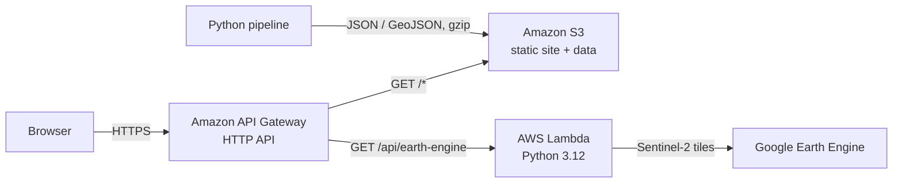

# Curupira

**Open-source environmental investigation platform for the Amazon.**
Curupira crosses the Rural Environmental Registry (CAR) with official deforestation, fire, mining, embargo and Indigenous Land data, so that anyone can see where the forest is under pressure and whether an alert falls inside a registered rural property.

**Live site:** https://nksewwbo9c.execute-api.us-east-1.amazonaws.com/
**Built for:** Reboot the Earth, the United Nations climate hackathon series led by UN OICT, in the edition held with NTT DATA.

> **Evidence for analysis, not a legal report.** Every number on the site is an indicator built from public data. An overlap does not prove an infraction, the CAR is self-declared, and a fire hotspot is not a burned area. Properties are identified only by their CAR code: no names, CPF or CNPJ are displayed or stored.

---

## Why "Curupira"

In Brazilian folklore, the Curupira is the guardian of the forest: a figure with fiery hair and backward feet that misleads hunters and loggers. The logo shows the guardian watching the territory, with hair in the shape of fire, the main threat the platform tracks.

---

## What it does

### 1. Alert-first map
The map opens on what matters: **3,083 real DETER/INPE alerts from the last 6 months across 54 municipalities of Amazonas**.
- Zoomed out, each municipality is a bubble with its alert count, colored by its highest priority.
- Zoomed in (level 9+), every alert becomes a point.
- Clicking a bubble or point fills the side panel: totals, hectares, alert types, the 5 most recent alerts and, for a single point, its class, date, area and coordinates.
- To validate, turn on **Rural properties (CAR)** and check whether the alert lies inside a declared perimeter.

| Priority | Rule |
|---|---|
| Critical | Deforestation or mining in the last 30 days |
| High | Older deforestation or mining, or fire scar / degradation in the last 30 days |
| Medium | Older fire scar or degradation |
| Low | Selective logging |

### 2. Activity filters
One-click shortcuts that turn on the right layers and alert classes for the selected municipality: **Indigenous Lands, Deforestation, Fire hotspots and burn scars, Embargoed areas, Logging, Gold mining and mining**. Each one explains what it shows.

### 3. Environmental layers
| Layer | Source |
|---|---|
| Rural properties (about 99,000 records in Amazonas) | SFB / SICAR |
| Indigenous Lands | FUNAI |
| Embargoed areas | Ibama (copy published by IPAAM) |
| Annual deforestation (2008 onward) | INPE / PRODES |
| Deforestation alerts (2016 onward), filterable by class and date | INPE / DETER |
| Mining processes | ANM / SIGMINE |
| Fire hotspots, all of Brazil (2003 to 2026) | INPE / Programa Queimadas |
| Sentinel-2 imagery (true color or NDVI) for any period up to 366 days | Copernicus via Google Earth Engine |

### 4. Attention index per property (0 to 100)
A rules-based score for every CAR, combining deforestation inside the property (PRODES area and share), DETER alerts by class, ANM processes and fire hotspots. **Overlap with an Indigenous Land or an embargo locks the score at 100.** Each municipality lists its top 20 properties. Weights are documented in `dist/data/atencao/pesos.json` and `docs/INDICE_ATENCAO_AM.md`.

### 5. Water pressure indicator (0 to 100 per municipality)
Rules-based estimate from DETER mining alerts (35%), ANM titles with authorized extraction (25%) and recent deforestation, PRODES 2023 to 2025 plus DETER in the last 3 years (40%). Each component is a percentile among the 62 municipalities, so a municipality with no signal scores 0. It is shown as an estimate. Satellite turbidity measurement is under development.

### 6. Reports in PDF
Exports require login (demo: `admin` / `admin`).
- **Property dossier:** CAR data plus its environmental context (Indigenous Land, embargo, PRODES hectares and share of the area, DETER alerts by class, ANM, fire hotspots, attention score, water pressure) and the analyst's notes.
- **Municipal report:** applied filters, CAR summary by status, DETER alerts by priority and class, how many properties overlap each layer, top 20 properties, water pressure, limitations and sources.
- **Alerts only:** full list of the municipality's alerts with date, type, area, priority and coordinates.
- **Property geometry** as GeoJSON, for QGIS or Google Earth.

---

## Architecture: 100% AWS



- **Amazon S3** hosts the site and all data as static files. There is no database: the pipeline does the heavy processing ahead of time, so the site is cheap and fast.
- **Amazon API Gateway (HTTP API)** provides HTTPS and routing. Data files are uploaded gzip-compressed (`Content-Encoding: gzip`) to stay under the 10 MB response limit.
- **AWS Lambda** (`aws/lambda-earth-engine`) builds a cloud-masked Sentinel-2 median mosaic of the municipality for the chosen period and returns the map tile URL.
- **Front end:** HTML, CSS and plain JavaScript with Leaflet.
- **Pipeline:** Python with Shapely, pyshp and pyproj. It downloads the official sources, repairs geometries, computes intersections per property and per municipality, and writes the files the site reads.

**Languages:** Python 48%, JavaScript 39%, CSS 9%, HTML 2%, PowerShell and Shell 2%.

---

## Repository layout

```
dist/                     static site (what goes to S3)
  assets/                 JavaScript, CSS, logo
  data/                   generated data (catalog, CAR, layers, alerts, indices)
tools/                    Python pipeline and generators
  alertas_am.py           6-month DETER alerts with priority
  atencao_am.py           attention index per property
  agua_am.py              water pressure indicator
aws/lambda-earth-engine/  Lambda code and deploy script
tests/                    Node and Python tests
docs/                     methodology, replication guide, source audit
```

Some large generated folders (per-municipality environmental layers, intersections, attention files, national fire hotspots) are not versioned. Rebuild them with the pipeline (see `docs/REPLICAR.md`).

---

## Run locally

```bash
cd dist
python -m http.server 8000
# open http://localhost:8000
```

## Rebuild the data

Follow `docs/REPLICAR.md` for sources, scripts and execution order. Use a virtual environment (`requirements.txt`). Derived indicators:

```bash
python tools/atencao_am.py
python tools/agua_am.py
python tools/alertas_am.py
```

## Tests

```bash
for t in tests/*.cjs; do node "$t"; done
python -m unittest discover tests
```

## Deploy on AWS

1. Create an S3 bucket with static website hosting.
2. Create an API Gateway HTTP API with a `GET /{proxy+}` route proxied to the bucket's website endpoint.
3. Upload `dist/`, with `.json` and `.geojson` files gzip-compressed and served with `Content-Encoding: gzip`.
4. Deploy the Earth Engine Lambda with `aws/lambda-earth-engine/implantar-lambda-earth-engine.ps1`. It creates the function, the `GET /api/earth-engine` route and the invoke permission. The Earth Engine project ID is read from `.env` and is never committed.

---

## Data sources and licenses

INPE (PRODES, DETER, Programa Queimadas), SFB/SICAR (CAR), FUNAI, Ibama, IPAAM, ANM, IBGE (municipal mesh 2025), Copernicus Sentinel-2 via Google Earth Engine, Esri basemap.

- PRODES and DETER data are **CC BY-SA 4.0**. Derived data redistributed from them keep the same license.
- SICAR publishes no license or terms of use. The CAR is used as a public registry, by CAR code only.
- The full source audit, with licenses and limits, is in `docs/`.

---

## Roadmap

- **AI change detection:** compare satellite images from different dates and raise the alert directly. For example, forest on day 26 and a burn scar on day 28.
- **LightGBM classifier** with SHAP explanations, calibrated and spatially cross-validated, to replace the rules-based attention index.
- **Permanent Preservation Areas (APP) and Legal Reserve** checks based on Law 12.651/2012.
- Deforestation for pasture and carbon stock per property (ESA CCI Biomass, always shown with its uncertainty).
- Satellite water turbidity downstream of mining, validated against ANA stations.
- **Nationwide coverage** with vector tiles (PMTiles), already tested on Amazonas.
- Real authentication with Amazon Cognito.

---

## Team

- Adalberto Alves Cruz
- Isabela Santana Camelo
- Renan Luz Barreto
- Otávio Silvia Souza Santana
- Felipe da Silva Prado

## License

Code: MIT License (see `LICENSE`). Data keep the licenses of their original sources. Derived data from PRODES/DETER are redistributed under CC BY-SA 4.0.

## Disclaimer

Curupira is an independent open-source project developed for the Reboot the Earth hackathon. It is not an official product of the United Nations or NTT DATA, and it is not affiliated with Ibama, INPE, SFB or any government agency. Its outputs are not official reports.
